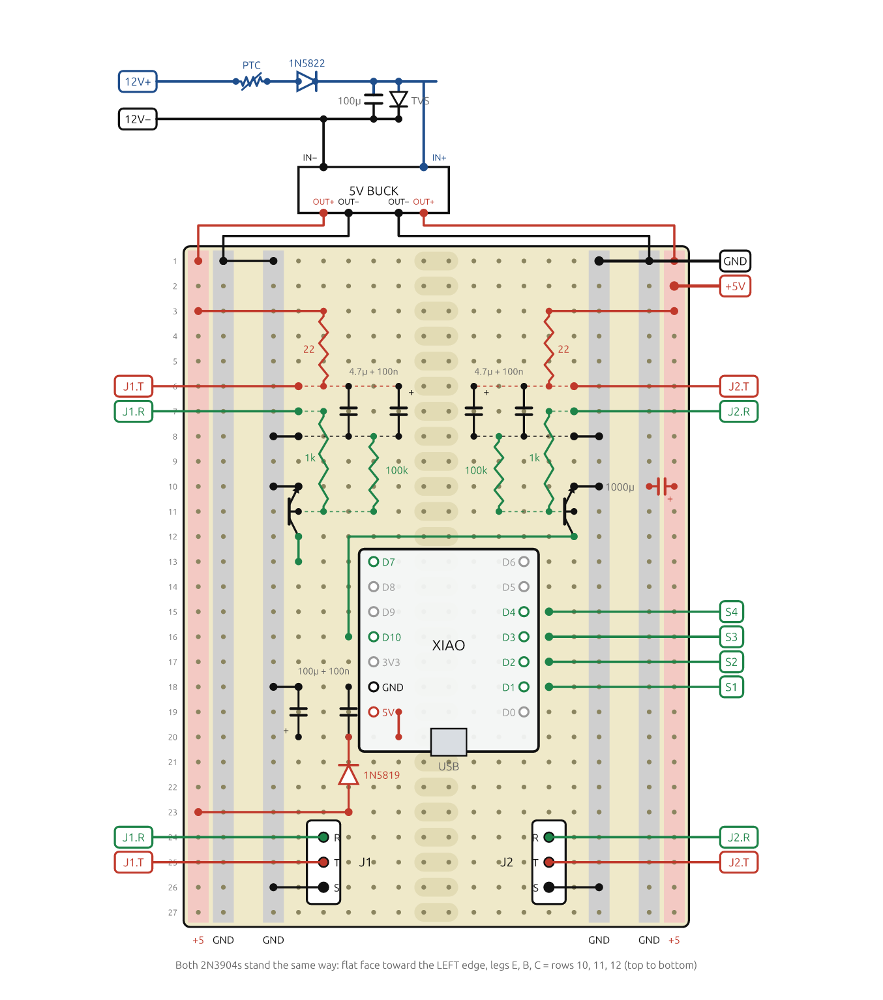

# Servo board — plan for a 4-servo remote on a 12 V input

Date: 2026-11-15 · **A plan, not a build. Nothing here has been wired.** Part numbers are
suggestions to check against their datasheets, not tested parts. Measured figures are marked
and come from `docs/07-servo-s51.md` and the bench on 2026-11-15.

The board carries a XIAO ESP32C3 running `firmware/jaw/` and up to **4 servos** (channels 1..4 on
D1, D2, D3, D4). It is fed from a **12 V power brick or the TalentCell 12 V battery**, whichever
is available, and makes its own 5 V.

---


*`../images/servo-board.svg` is the source. Pin order on the XIAO is simplified; use its silkscreen.*

## 1. Power budget

| Load | At 5 V | Basis |
|---|---|---|
| XIAO, radio on, idle | **94 mA** | measured 2026-11-15, meter in series with the 5V pin |
| Servo holding | ~3 mA each | measured (S51, no load) |
| Servo moving, free lever | ~61 mA each | measured, MAX mode (S51) |
| Servo stalled | **459 mA** each | measured, lever held by hand (S51) |

- Typical show: the XIAO plus a few servos moving, about **0.2–0.4 A at 5 V**.
- Worst case, all four stalled: about **1.8 A + 0.1 A**. Set `loDeg`/`hiDeg` so this does not
  happen, but size the supply for it anyway: **a 5 V converter rated for at least 3 A.**
- From the 12 V source that is roughly **0.1 A typical and 0.2 A worst case at 12 V**
  (5 V × current ÷ 12 V ÷ ~0.85 efficiency; not measured).

## 2. Power path

```
 12 V in (barrel jack or screw terminal)
   │
   ├─ fuse (~2 A, resettable) ─ reverse-polarity protection ─ TVS across the input
   │
   └─ 5 V buck converter, >= 3 A ──┬── servo bus: 470–1000 µF bulk cap (the only cap on the servo side) ──> 4 servo headers (+)
                                   │
                                   └── Schottky (1N5819) ── XIAO 5V pin (+ 100 µF at the pin)

 GND: one star point. Servo ground returns and the XIAO GND meet there; the buck's GND too.
```

- **Servo power never passes through the XIAO.** The XIAO has its own diode-fed tap so a servo
  starting or stalling cannot reset it. Seeed requires the series Schottky on the 5V pin.
- **Converter:** pick one with a wide input (a 12 V battery reads about 12.6 V full and a brick
  may sit above 12 V unloaded), for example a Pololu D36V28F5-class 5 V, 3.2 A step-down
  (6–50 V in). Check the datasheet. Cheap LM2596-class modules work but are noisy.
- **Keep the converter away from the XIAO's antenna.** Its inductor radiates, and the link is the
  whole point.
- **Stay at 5 V.** The S51 allows 6 V but `docs/07` says not to run it there on a guess.
- **Input protection is for a borrowed prop.** Bricks and batteries are both easy to connect
  backwards, and a brick can spike. Use a series diode or P-channel MOSFET for polarity, a TVS
  (SMBJ15A-class) across the input, and a ~2 A resettable fuse. **Meter the brick's polarity**
  before the first connection: barrel-jack centre polarity is not universal.

## 3. Servo connectors and signal

One **3-pin 0.1" male header per servo**, in the S51's own order so the servo plugs straight in
(no crossed wires, unlike the JST adapter in `docs/07` §8):

| Header pin | Wire (S51) | Goes to |
|---|---|---|
| 1 | orange, signal | XIAO pin (table below), nothing else on the line |
| 2 | red, +5 V | the servo bus (after the bulk cap) |
| 3 | brown, GND | the GND star point |

| Channel | XIAO silkscreen | GPIO |
|---|---|---|
| 1 | D1 | GPIO3 |
| 2 | D2 | GPIO4 |
| 3 | D3 | GPIO5 |
| 4 | D4 | GPIO6 |
| *never* | D0, D8, D9 | GPIO2, 8, 9 — strapping, see CLAUDE.md |

3.3 V signals drive the S51 directly (measured); no level shifter. A 100–330 Ω series resistor on
each signal is optional protection. There are **no per-servo pull-downs or caps**: the pull-downs did not stop the boot twitch when tried, and the one bulk cap serves all four servos.

D7 (GPIO20) and D10 (GPIO10) are the two sensor inputs (§7), on the opposite edge of the XIAO from the
servos. D7 is the UART receive pin and is free because the board talks over USB. D5 and D6 are unused (D6 is
the UART transmit pin and prints boot messages).

## 4. Before first power

1. Power from the brick with the **XIAO and servos unplugged**; meter 5 V on the servo bus and
   at the XIAO's diode output (about 0.3 V lower), and 0 V on every signal pin.
2. Plug the XIAO in alone and check it comes up and answers on the radio.
3. Plug servos in one at a time. Meter the signal pin on each header with `jaw.ino` running.
4. Confirm with the meter that the brick's centre-pin polarity matches the board's before use.

## 5. Still unknown

- Whether the TalentCell's 12 V output keeps running at this small a draw (around 0.1 A at 12 V);
  some batteries cut off at low current. Not measured.
- The converter's behaviour under a four-servo stall, and the bus voltage at the servos then.
- Real runtime on the battery.

---

## 6. Parts list

**Inventory:** no personal inventory file turned up under `/home/shschubert`. The "On hand?" column
uses only what two project files say: **OWNED** is from the SFX Box BOM
(`SFX box/reference/sfx-box-bom-v3.xlsx`), **[bin?]** is `docs/05-parts.md`'s own guess, and
**?** means no file says. Check it against your shelf.

**Part numbers are from memory and are suggestions. Check each against its datasheet or listing
before ordering.**

| # | Part | Part number / spec | Qty | On hand? | Notes |
|---|---|---|---|---|---|
| 1 | Controller | Seeed XIAO ESP32C3 (SKU 113991054) | 1 | **yes** (2 per `05-parts.md`; one is the bar) | the jaw board already runs `jaw.ino` |
| 2 | 5 V buck converter | **MP1584EN module** (the EBOOT 6-pack) | 1 | **OWNED** (SFX BOM) | set to 5.0 V *before* connecting anything. Fine for a typical show. Marginal for four servos stalling at once (~1.9 A): these are rated 3 A peak but run hot near that |
| 2b | *or* a stronger buck | Pololu D36V28F5, 5 V 3.2 A step-down, 6–50 V in (Pololu #3782) | 1 | ? | the safe choice if you want the all-stalled worst case covered |
| 3 | Schottky, XIAO 5V feed | 1N5819 (DO-41) | 1 | **yes** (owned) | Seeed requires it on the 5V pin |
| 4 | Reverse-polarity diode | 1N5822 (3 A, 40 V); SB340 or 1N5823 also fit | 1 | **buying** | in series at the 12 V input; costs ~0.4 V, harmless into a buck. A 1N5819 (1 A) would run at its limit with all four servos stalled |
| 5 | TVS diode | **P6KE15A** (through-hole, unidirectional, no "CA" suffix) | 1 | **buying** | across the buck's IN+ and IN− pads, band to +. The SMD SMBJ15A is the same part electrically |
| 6 | Resettable fuse | 16 V plug-in PTC kit (0.5–10 A); use the **2 A** | 1 | **buying** (kit) | first part on the 12 V input. 16 V is fine for 12–12.6 V; check the brick's no-load voltage stays under 16 V. Worst-case draw on this side is about 1 A |
| 7 | Bulk cap, servo bus | 1000 µF, 16 V electrolytic | 1 | **[bin?]** | at the buck output; 470 µF also acceptable |
| 8 | Input cap | 100 µF, 25 V electrolytic | 1 | ? | at the buck input |
| 9 | XIAO feed cap | 100 µF, 10 V or higher | 1 | ? | at the XIAO 5V pin, after the Schottky; it only has to carry the XIAO (~100 mA, radio bursts higher) through short dips |
| 10 | Ceramic cap | 100 nF, 50 V | 1 | ? | one at the XIAO 5V pin |
| 11 | *(removed: signal pull-downs)* | | 0 | | not needed |
| 12 | Signal series resistors (optional) | 100–330 Ω, 1/4 W | 4 | **[bin?]** | optional protection |
| 13 | Servo headers | 3-pin 2.54 mm male header (break from a 40-pin strip) | 4 | ? | signal, +5 V, GND, in the S51's own order |
| 14 | XIAO sockets | 7-pin 2.54 mm female header | 2 | ? | so the XIAO can be removed and reflashed |
| 15 | Power input | 5.5 × 2.1 mm barrel jack, panel or PCB mount, plus a 2-pin 5.08 mm screw terminal | 1 each | **OWNED** (barrel jacks and screw terminals, SFX BOM) | **meter the brick's polarity**; centre-positive is common, not universal |
| 16 | Board | perfboard, the size used for the bar | 1 | ? | |
| 17 | Wire | 20 AWG for the power bus, 22 AWG silicone for signals | — | **[bin?]** (22 AWG) | |
| 18 | Servos | Smraza S51, 9 g | 2–4 | **yes** (2 on the bench) | |
| 19 | Motion sensor (optional) | HC-SR501 PIR or VL53L1X ToF | 1 | **OWNED** (VL53L1X, SFX BOM); HC-SR501 listed as optional stock | the box handles triggers today; this is only for a standalone board |
| 19b | Sensor port parts (×2) | 3.5 mm stereo jack, 2N3904, 1 kΩ, 100 kΩ, 22 Ω, 4.7 µF, 100 nF | 2 sets | **?** (the SFX Box's ports use the same parts) | see §7 |
| 20 | 12 V sources | 12 V brick (5.5 × 2.1 mm) · TalentCell YB1206000 12 V battery | 1 each | **yes** (TalentCell, `05-parts.md`); the brick **OWNED** per the SFX BOM | the box's 12 V PSU is the same class of brick |

**Not a part, but needed:** a DMM for the first-power checks in §4 (you have the DM6000AR).

---

## 7. Two sensor ports (D7, D10)

Same port as the SFX Box's (`SFX box/sfx-box-wiring.md`, "Sensor daughter board"), so the same
sensor plugs into either: **3.5 mm stereo jack, Tip = +5 V, Ring = signal, Sleeve = GND.** A Neumi
motion sensor (3.3 V output on motion) or a plain push button wired Ring to Tip both work.

Per port: the 22 Ω from the 5 V bus feeds Tip (absorbing the momentary short as a plug seats,
with 4.7 µF + 100 nF at that node); Ring goes through 1 kΩ to the base of an NPN (2N3904), with
100 kΩ from the base to GND; the emitter is GND; the collector goes to the XIAO pin, whose
**internal pull-up** is on. The stage level-shifts and **inverts: motion pulls the pin LOW.**

**Firmware:** `firmware/jaw/jaw.ino` debounces both inputs (30 ms) and announces each change
unasked over the radio:

    ev sensor <n> <0|1> <seq>        1 = active (pin LOW), 0 = released

Each event goes out 3 times, 40 ms apart, with the same `seq`; the receiver ignores a repeat of
the same (n, state, seq). The bridge needs no change: it already prints anything a prop says,
tagged `jaw>`. `sens` reads the two inputs back (`sens 1=0 2=0`) and `st` carries `sens=00`.
**Not done:** the SFX Box does not yet read unsolicited `ev` lines or offer them as triggers.

Bench test without the circuit: the pins idle HIGH, so touching a wire from D7 or D10 to GND
looks like motion.

Parts for the two ports (copied from the SFX Box's list, per port): 1 × 3.5 mm stereo jack, 1 ×
2N3904 (MMBT3904 or BC547 also work), 1 × 1 kΩ, 1 × 100 kΩ, 1 × 22 Ω, 1 × 4.7 µF, 1 × 100 nF.

## 8. Layout on the SB400-style board



**What I assumed from the photo of the light-bar board** (count against your own board before soldering;
the layout is relative to the XIAO, so a column or two of difference only shifts things):

- Two vertical rail strips on each side. Rows run left-right and are **cut at the centre channel**, so every
  row is two separate nets: the left half (columns 1–6) and the right half (columns 7–12). A part that
  straddles the channel (like the diode in your photo) joins the two halves.
- About 28 rows. Rows are numbered from the top in the drawing.
- Rails: **inner strip (next to the holes) = GND, outer strip = +5 V**, on both sides.

**Why the XIAO is turned so the USB end points at the bottom:** the four servo pins D1–D4 are on one edge of
the XIAO and the two sensor pins D7 and D10 are on the other. Turned this way the servos land on the right
half, beside the right rail, and the sensor circuits and jacks sit on the left half beside the left rail, so
each side of the box has one kind of connector. Rotate the whole board 180° in the box if the USB end should
face elsewhere; the design is mirror-symmetric in what it needs.

**XIAO position:** left pins in left-half column 3, right pins in right-half column 10, rows 16–22. Holes
at left columns 1–2 and right columns 11–12 stay free beside the pins. Rows above row 15 and below row 23
are free across both halves.

| Rows | Left pin | Right pin |
|---|---|---|
| 16 | **D7** sensor 1 | D6 (unused) |
| 17 | D8 (avoid) | D5 (unused) |
| 18 | D9 (avoid) | **D4** servo 4 |
| 19 | **D10** sensor 2 | **D3** servo 3 |
| 20 | 3V3 (unused) | **D2** servo 2 |
| 21 | GND | **D1** servo 1 |
| 22 | 5V | D0 (avoid) |

### Hole list (row, side-column; `L`/`R` = left/right half, rail = `L5 LG R5 RG`)

**12 V side, off the board.** The 12 V parts sit above the buck module and the 5 V side below it, so the
buck is the only thing between them: barrel jack + → PTC fuse → 1N5822 (band toward the buck) → buck IN+,
with the 100 µF 25 V and the TVS (P6KE15A, band to +) from that node to GND, and jack GND → buck IN−. Build
it on the buck's own bit of board or wire it point to point. Nothing from this chain goes on the SB400 board.

**5 V side, on the board** (rows 1–2 are spare)

| Part | From | To |
|---|---|---|
| Buck OUT+ / OUT− | L5 rail row 1 | LG rail row 1 |
| Bridge +5 V (wire) | L5 rail row 27 | R5 rail row 27 |
| Bridge GND (wire) | LG rail row 28 | RG rail row 28 |
| 1000 µF 10 V+ (+ to outer rail) | R5 rail row 26 | RG rail row 26 |

Bridge the rails with wire, not just the strips: four stalled servos draw about 1.9 A.

**Sensor ports, all on the left half.** Same circuit twice. Port 1 uses rows 3–8 and goes to **D7**; port 2 uses
rows 9–14 and goes to **D10**. Values below are for port 1; add 6 rows for port 2 (tip row 9, ring row 10, and so on).

| Part | From | To |
|---|---|---|
| 22 Ω | L5 rail row 4 | L row 3, col 2 |
| 4.7 µF (+ to the row) | L3 col 1 | LG rail row 3 |
| 100 nF | L3 col 1 | LG rail row 4 |
| Jack tip wire | L3 col 4 | |
| Jack ring wire | L4 col 4 | |
| Jack sleeve wire | LG rail row 5 | |
| 1 kΩ (lies along the column, 0.3–0.4") | L4 col 5 | L7 col 5 |
| 2N3904, flat face toward the left, standing in col 3 | emitter L6, base L7, collector L8 | |
| Emitter jumper | L6 col 1 | LG rail row 6 |
| 100 kΩ | L7 col 2 | LG rail row 7 |
| Collector wire (insulated, lies over the board) | L8 col 6, down col 6 to row 15, left along row 15 to col 2 | L16 col 2 (next to **D7**) |
| Port 2 collector wire | L14 col 1, straight down col 1 | L19 col 1 (next to **D10**) |

**XIAO power and servos**

| Part | From | To |
|---|---|---|
| GND jumper | L21 col 2 | LG rail row 21 |
| 1N5819 (band to the XIAO) | cathode L22 col 2 | anode L26 col 2 |
| Anode jumper | L26 col 1 | L5 rail row 26 |
| 100 µF (+ to row 22) and 100 nF | L22 col 1 | L21 col 1 |
| Servos 1, 2, 3, 4: signal | R21 / R20 / R19 / R18, col 11 | |
| Servos 1–4: + / − | R5 rail / RG rail, same row as the signal | |

**Soldering order that keeps things reachable:** rails and bridge wires, then the two sensor circuits, then the diode and caps beside the XIAO, then the XIAO last (it covers the
holes under it). Meter each rail for continuity to the far end, and meter across the channel on a spare row
to confirm the halves are isolated, before the XIAO goes in.

**Mounting the buck module.** The MP1584EN modules have four pads (IN+, IN−, OUT+, OUT−) and no pins, and
they don't land on a 0.1" grid, which is why they won't drop into a perfboard. The usual way is simply wires:
tin each pad, solder a short 22 AWG wire (red for +, black for −), add a dab of hot glue over the joints as strain
relief, and stick the module down with double-sided foam tape. Set the output to 5.0 V with a meter
*before* connecting anything to it.

**Keep the buck module off the board, a few cm from the XIAO.** Its inductor is the noisiest thing in the box.
